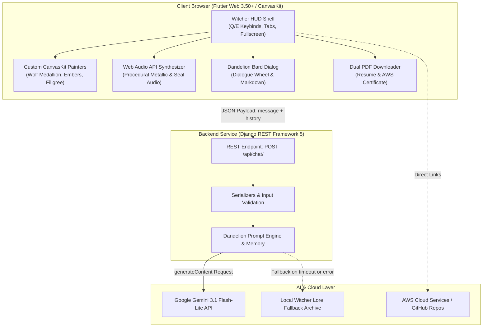

# ⚔️ Anshul of AI — Grandmaster Witcher of the Neural School
### *An Immersive Witcher 3: Wild Hunt-Themed Developer Portfolio & AI Companion*

[](https://flutter.dev)
[](https://www.django-rest-framework.org/)
[](https://ai.google.dev/)
[](https://aws.amazon.com/verification)
[](https://www.python.org/)
[](https://thewitcher.com)
[](LICENSE)

> *"Toss a contract to your Witcher, O Valley of Silicon..."*  
> Welcome to the digital sanctuary of **Anshul Arohi**, an AI & Machine Learning Engineer (B.Tech CSE [AI & ML], VIT Vellore 2023–2027, AWS Certified ML Engineer – Associate). Step into an authentic recreation of *The Witcher 3: Wild Hunt* user interface, complete with in-game sound design, dynamic ambient ember physics, full keyboard inventory navigation, and an autonomous AI bard scribe.

---

## 🐺 Highlights & Realm Features

- **🎮 Authentic Witcher 3 In-Game HUD**
  - **Q / E Tab Switching**: Cycle through character tabs with keyboard shortcuts just like the inventory screen in *The Witcher 3*.
  - **Gold Hairline Filigree & Medallion**: Double-border parchment framing with corner rivets and a custom-drawn Wolf Medallion vector painter.
  - **Kinetic Floating Embers**: A continuous 60fps upward-drifting amber and crimson fire particle system rendered with custom Flutter shaders.
  - **Synthesized Web Audio API**: Native metallic sword clinks, parchment rustles, and royal wax seal presses generated without heavy audio asset files.
  - **⛶ Immersive Fullscreen Mode**: 1-click native toggle for a borderless desktop game experience.

- **🪶 Dandelion the Master Scribe (AI Chatbot)**
  - Embedded bottom-right interactive bard chat window powered by **Google Gemini 3.1 Flash-Lite** through a **Django REST Framework** API.
  - Fully in-character response generation with bardic flair, dramatic lute plucks, and comprehensive knowledge of Anshul's projects, skills, education, and credentials.
  - **Multi-turn conversation history** and instant **zero-latency offline fallback lore engine** if network connectivity is severed.
  - Quick-prompt dialogue wheel chips for frictionless inquiry.

- **📜 The Quest Log (Witcher Contracts)**
  - Master-detail interactive quest viewer with threat assessments, beast difficulty ratings, client details, and live GitHub redirects:
    - **FraudLens** (`COMPLETED`): Credit Card Fraud Detection (XGBoost, Isolation Forest, PR-AUC 0.8589, ROC-AUC 0.9971, Django REST API, Flutter Mobile HUD) → [GitHub Repo](https://github.com/Anshul-3107/FraudLens)
    - **Leaf Compass** (`COMPLETED`): Plant Pathology & Crop Intelligence (Custom CNN, 38 PlantVillage Classes, FastAPI Microservices, Docker) → [GitHub Repo](https://github.com/Anshul-3107/Leaf-Compass)
    - **InfraIntel** (`ONGOING`): Cloud Infrastructure Telemetry & Autonomous Anomaly Prediction (FastAPI, Docker, Microservices) → [GitHub Repo](https://github.com/Anshul-3107/InfraIntel)

- **🔮 The 5 Witcher Signs & Alchemy Arsenal**
  - **Igni (Fire)**: Deep Learning & ML Foundations (PyTorch, TensorFlow, Scikit-learn, XGBoost, Isolation Forest)
  - **Axii (Mind)**: NLP & Large Language Models (Hugging Face Transformers, Gemini API, Prompt Engineering, RAG)
  - **Aard (Telekinesis)**: Backend & High-Throughput APIs (FastAPI, Django REST Framework, Python, REST APIs)
  - **Quen (Shield)**: Cloud, Containerization & DevOps (AWS EC2/S3/SageMaker, Docker, CI/CD, Git)
  - **Yrden (Trap)**: Cross-Platform Interface Engineering (Flutter, Dart, CanvasKit WebGL, Responsive HUD Design)
  - **Alchemy Tiers**: Categorized armor ratings from *Grandmaster* to *Mastercrafted*, *Superior*, and *Enhanced*.

- **📌 Velen Notice Board & Guild Dispatch**
  - **Claim Dossier**: 1-click dual-file download delivering both official **Resume PDF** and **AWS Certified ML Engineer Certificate PDF** with authentic wax seal audio.
  - **Direct Royal Dispatch**: Seamless Gmail pre-filled compose, instant WhatsApp chat (`wa.me/919508327460`), LinkedIn, and LeetCode shortcuts.

- **📖 Bestiary & Academic Glossary**
  - Academic chronicles from **Vellore Institute of Technology (VIT Vellore)** (CGPA: 7.51/10).
  - AWS Certification dossier with official Validation ID `1cb4efb1d7f64bf7a9688e7e494d7676` and live AWS verification hyperlink.

---

## 🏛️ System Architecture



---

## ⌨️ Witcher HUD Controls & Keybindings

| Key / Control | Action | Audio Feedback |
| :--- | :--- | :--- |
| <kbd>Q</kbd> or <kbd>←</kbd> | Navigate to previous inventory tab | Low resonant parchment whoosh |
| <kbd>E</kbd> or <kbd>→</kbd> | Navigate to next inventory tab | Low resonant parchment whoosh |
| `[ ⛶ FULLSCREEN ]` | Toggle native borderless browser fullscreen | Metallic blade clink |
| `[ 🕪 AUDIO ]` | Mute or unmute synthesized Web Audio effects | Sound toggle cue |
| `[ 📜 CLAIM DOSSIER ]` | Download both Resume and AWS Certificate PDFs | Heavy wax seal stamping thud |
| `[ 🪶 CONSULT DANDELION ]` | Open / close AI Bard chat parchment dialog | Feather quill rustle & harp strum |

---

## 📂 Project Structure

```text
portfolio/
├── backend/                             # Django REST Framework Backend
│   ├── manage.py                        # Django administrative runner
│   ├── Procfile                         # Production deployment entrypoint (Gunicorn)
│   ├── requirements.txt                 # Python dependencies
│   ├── portfolio_backend/               # Core project configuration
│   │   ├── settings.py                  # CORS, Apps, Security & Gemini config
│   │   ├── urls.py                      # URL routing
│   │   └── wsgi.py                      # WSGI specification
│   └── chatbot/                         # Dandelion AI application
│       ├── services.py                  # Gemini 3.1 Flash-Lite integration & system prompt
│       ├── views.py                     # POST /api/chat/ controller
│       ├── serializers.py               # Request/Response schemas
│       └── urls.py                      # Chatbot route registration
│
├── lib/                                 # Flutter Web Frontend
│   ├── main.dart                        # Flutter entrypoint & theme definition
│   ├── core/
│   │   ├── audio/                       # Web Audio API procedural synthesis bridge
│   │   ├── constants/resume_data.dart   # Portfolio data, stats & contract definitions
│   │   └── theme/                       # Witcher color palette & typography
│   ├── models/portfolio_models.dart     # Data classes for contracts, skills & lore
│   ├── screens/
│   │   ├── witcher_hud_scaffold.dart    # HUD header, Q/E key listener, audio & fullscreen
│   │   └── tabs/
│   │       ├── character_tab.dart       # Character sheet, telemetry & AWS mutagen
│   │       ├── contracts_tab.dart       # Witcher quest log (FraudLens, Leaf Compass, InfraIntel)
│   │       ├── signs_tab.dart           # Interactive 5 Signs & Alchemy skills
│   │       ├── notice_board_tab.dart    # Velen notice board, PDF download & direct contact
│   │       └── glossary_tab.dart        # Academic achievements & AWS verification
│   ├── services/dandelion_service.dart  # Client HTTP service & fallback lore generator
│   └── widgets/                         # Reusable Witcher aesthetic components
│       ├── dandelion_chat_dialog.dart   # Witcher parchment chatbot window
│       ├── ember_particles.dart         # 60fps upward ambient fire particles
│       ├── runic_button.dart            # Gold-bordered rune action buttons
│       ├── stat_bar.dart                # Health / stamina combat gauges
│       ├── tier_badge.dart              # Grandmaster / Mastercrafted badges
│       ├── witcher_card.dart            # Ornate gold hairline double-border card
│       └── witcher_medallion.dart       # Custom vector wolf head medallion painter
│
├── web/                                 # Web platform assets
│   ├── index.html                       # Fonts, CanvasKit setup & Web Audio script
│   ├── Anshul_Arohi_Resume.pdf          # Official resume file
│   └── AWS_Certified_Machine_Learning_Engineer_Associate.pdf # Official AWS cert
└── pubspec.yaml                         # Flutter dependencies (url_launcher, http)
```

---

## 🚀 Local Development Setup

### Prerequisites
- [Flutter SDK](https://docs.flutter.dev/get-started/install) (`v3.24+` or `v3.50+`)
- [Python](https://www.python.org/) (`v3.11+`)
- [Git](https://git-scm.com/)
- A [Google Gemini API Key](https://aistudio.google.com/app/apikey) (Free tier available)

---

### Step 1: Clone the Repository
```bash
git clone https://github.com/Anshul-3107/portfolio.git
cd portfolio
```

---

### Step 2: Configure & Run Django Backend

1. Navigate to the backend directory and set up a virtual environment:
   ```bash
   cd backend
   python -m venv venv
   ```

2. Activate the virtual environment:
   - **Windows (PowerShell):**
     ```powershell
     .\venv\Scripts\Activate.ps1
     ```
   - **macOS / Linux:**
     ```bash
     source venv/bin/activate
     ```

3. Install Python dependencies:
   ```bash
   pip install -r requirements.txt
   ```

4. Create an environment file `.env` in the `backend/` directory:
   ```env
   DJANGO_SECRET_KEY=your-secure-secret-key-here
   DEBUG=True
   GEMINI_API_KEY=your-gemini-api-key-here
   ```

5. Run database migrations:
   ```bash
   python manage.py migrate
   ```

6. Start the local DRF development server:
   ```bash
   python manage.py runserver 127.0.0.1:8000
   ```
   *The backend will be live at `http://127.0.0.1:8000/api/chat/`.*

---

### Step 3: Run Flutter Web Frontend

1. In a separate terminal, navigate to the project root:
   ```bash
   cd d:\portfolio
   ```

2. Fetch Flutter packages:
   ```bash
   flutter pub get
   ```

3. Launch in Chrome with hot reload:
   ```bash
   flutter run -d chrome
   ```

4. Or build and serve the optimized production web package:
   ```bash
   flutter build web --release
   python -m http.server 8080 --directory build/web
   ```
   *Open [http://localhost:8080](http://localhost:8080) to experience the full Witcher HUD.*

---

## 🌐 Production Deployment Guide

### Backend Deployment (Render / Railway)
The backend is packaged with `gunicorn`, `Procfile`, and `django-cors-headers` for 1-click cloud deployment:

1. Push your code to GitHub.
2. In **Render** or **Railway**, create a new **Web Service** pointing to the `backend/` directory.
3. Configure settings:
   - **Build Command:** `pip install -r requirements.txt && python manage.py migrate`
   - **Start Command:** `gunicorn portfolio_backend.wsgi:application`
   - **Environment Variables:**
     - `GEMINI_API_KEY` = *[Your Gemini API Key]*
     - `DJANGO_SECRET_KEY` = *[Random 50+ character string]*
     - `DEBUG` = `False`
4. Copy your deployed URL (e.g., `https://anshul-portfolio-backend.onrender.com`).
5. Update `lib/services/dandelion_service.dart` line 33 with your deployed backend URL.

### Frontend Deployment (Vercel / GitHub Pages / Firebase)
1. Run the production build command:
   ```bash
   flutter build web --release
   ```
2. Deploy the `build/web/` folder:
   - **Vercel**: Import the repository, set Root Directory to `build/web` (or deploy via `vercel deploy --prod build/web`).
   - **GitHub Pages**: Push the contents of `build/web` to the `gh-pages` branch.
   - **Firebase Hosting**: Run `firebase init hosting` (public directory: `build/web`) followed by `firebase deploy`.

---

## 📜 Witcher Contracts (Featured Projects)

### 1. [FraudLens — Real-Time Credit Card Fraud Detection](https://github.com/Anshul-3107/FraudLens)
- **Class**: Mastercrafted Financial Defense
- **Threat Level**: Lethal (Severe class imbalance, 0.172% fraud incidence)
- **Solution**: Engineered an end-to-end fraud mitigation architecture blending **XGBoost** and **Isolation Forest** algorithms. Achieved a test **PR-AUC of 0.8589** and **ROC-AUC of 0.9971**. Served through an asynchronous Django REST API with a companion Flutter mobile HUD.
- **Arsenal**: Python, XGBoost, Scikit-learn, Django REST Framework, Flutter, Pandas, NumPy.

### 2. [Leaf Compass — Botanical Pathology & Crop Intelligence](https://github.com/Anshul-3107/Leaf-Compass)
- **Class**: Mastercrafted Agricultural Runes
- **Threat Level**: Widespread Botanical Blight
- **Solution**: Designed a deep convolutional neural network (CNN) trained across the PlantVillage dataset to classify **38 distinct crop leaf diseases** with real-time inference. Integrated dynamic yield prediction and fertilizer dosage advisory microservices containerized with Docker.
- **Arsenal**: PyTorch, Custom CNN, FastAPI, Docker, OpenCV, Python.

### 3. [InfraIntel — Autonomous Cloud Telemetry & Outage Sentry](https://github.com/Anshul-3107/InfraIntel)
- **Class**: Superior SRE Automaton
- **Status**: `ONGOING`
- **Solution**: An autonomous cloud infrastructure observability intelligence engine designed to detect multi-node telemetry drifts, anomalous latency spikes, and server failures before outages occur.
- **Arsenal**: FastAPI, Docker, Python, Microservices, Time-Series Anomaly Detection.

---

## 📬 The Notice Board (Contact & Guild Affiliations)

Looking to recruit Anshul for a high-priority machine learning contract, research fellowship, or engineering role?

- **Grandmaster**: Anshul Arohi
- **Guild**: B.Tech Computer Science & Engineering (AI & ML), VIT Vellore (2023–2027)
- **Credential**: AWS Certified Machine Learning Engineer – Associate (*Validation ID: `1cb4efb1d7f64bf7a9688e7e494d7676`*)
- **Official Raven (Email)**: [anshularohi31072004@gmail.com](mailto:anshularohi31072004@gmail.com)
- **Fast Courier (WhatsApp)**: [+91 9508327460](https://wa.me/919508327460)
- **LinkedIn Guild**: [linkedin.com/in/anshularohi](https://www.linkedin.com/in/anshularohi/)
- **GitHub Armory**: [github.com/Anshul-3107](https://github.com/Anshul-3107)
- **LeetCode Dojo**: [leetcode.com/u/AnshulArohi](https://leetcode.com/u/AnshulArohi/)

---

## 🛡️ License

This project is licensed under the **MIT License** — feel free to explore, learn from the codebase, and forge your own legendary developer armory.

*Inspired by CD PROJEKT RED's The Witcher 3: Wild Hunt. All Witcher lore references are tribute creations for non-commercial portfolio presentation.*
