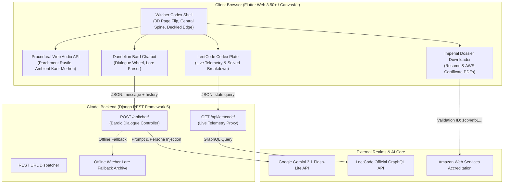

<div align="center">

# ⚔️ ANSHUL OF AI ⚔️
### *Grandmaster Witcher of the Neural Wolf School*

**An Immersive, 3D Page-Flipping Grimoire & Developer Codex Inspired by *The Witcher 3: Wild Hunt***

```
═══════════════════════════════════════════════════════════════════════════════════
   🐺  VELEN  •  NOVIGRAD  •  SKELLIGE  •  KAER MORHEN  •  VALLEY OF SILICON  🐺
═══════════════════════════════════════════════════════════════════════════════════
```

[](https://flutter.dev)
[](https://www.django-rest-framework.org/)
[](https://ai.google.dev/)
[](https://aws.amazon.com/verification)
[](https://www.python.org/)
[](https://thewitcher.com)
[](LICENSE)

<br/>

> *"A Witcher’s silver blade strikes down anomalous beasts in the dark,  
> just as a neural network unmasks fraud hidden within millions of transactions."*

<br/>

[⚔️ Explore the Codex](#-chronicles-of-the-codex) • [📜 Witcher Contracts](#-witcher-contracts-flagship-projects) • [🔮 The 5 Signs](#-the-5-witcher-signs--alchemy-arsenal) • [🪶 Consult Dandelion](#-dandelion-the-master-scribe-ai-companion) • [📬 Send Raven](#-the-velen-notice-board-contact)

</div>

---

## 🐺 Character Dossier: Anshul Arohi

<div align="center">

| Metric | Chronicle |
| :--- | :--- |
| **Title & School** | **Anshul of AI** — *Grandmaster of the Neural Wolf School* |
| **Class** | AI & Machine Learning Engineer • Python Backend Specialist |
| **Academic Citadel** | **Vellore Institute of Technology (VIT Vellore)** — B.Tech CSE (AI & ML), 2023–2027 |
| **Accreditation** | **AWS Certified Machine Learning Engineer – Associate** *(Validation ID: `1cb4efb1d7f64bf7a9688e7e494d7676`)* |
| **Silver Sword** | PyTorch, XGBoost, Isolation Forest, Scikit-learn, Custom CNNs |
| **Steel Sword** | Python, FastAPI, Django REST Framework, Docker, PostgreSQL, Flutter CanvasKit |
| **Sign Casting** | *Igni* (Deep Learning), *Axii* (APIs), *Aard* (UI/UX), *Quen* (Cloud & SRE), *Yrden* (DBMS/OOP) |
| **Companion** | **Dandelion the Bard** — Autonomous AI Scribe powered by Google Gemini 3.1 Flash-Lite |

</div>

---

## 📖 Chronicles of the Codex

Rather than a generic modern developer portfolio, this project reconstructs an authentic, full-screen **Witcher 3 Grimoire & Tome of Lore** using Flutter Web CanvasKit and procedural Web Audio synthesis:

### 1. 📜 Tactile 3D Page-Flipping Architecture
* **True 3D Spine Perspective:** Pages pivot around the central binding trench using 3D perspective matrix transformations (`Matrix4..setEntry(3, 2, 0.0012)`), simulating the physical curvature of opening an antique leather-bound codex.
* **Deckled Vellum Edges & Foxing:** Procedural canvas painters generate weathered deckle edges, antique tea/soot stains, foxing specks, and 5 hand-stitched binding cords crossing the central spine gutter.
* **Receiving Drop-Shadow Physics:** Dynamic gradient drop shadows sweep across the opposite page spread in sync with the flip curve (`Curves.easeInOutCubic`).

### 2. ⚡ Live LeetCode Telemetry Manuscript Plate
* **Real-Time Problem Telemetry:** Live integration with the LeetCode GraphQL API proxied through the Django REST backend (`/api/leetcode/?username=anshularohi`).
* **Manuscript Codex Aesthetics:** Renders live metrics—total solved, global ranking, acceptance rate, and Easy/Medium/Hard problem splits—directly onto antique illuminated vellum plates.

### 3. 🎧 Calibrated Witcher Ambient Soundscape
* **Authentic Vellum Page Turn Rustle:** Web Audio API synthesizes realistic parchment friction noise (`380Hz – 1400Hz`) paired with a subtle sub-bass air displacement sweep (`85Hz → 32Hz`) on every tab change.
* **Quiet, Aesthetic Soundtrack:** Gentle atmospheric music (*Kaer Morhen* and *The Fields of Ard Skellig*) calibrated to a soft background level (`0.045 volume`), fading smoothly between tracks.
* **Whisper-Quiet UI:** Zero jarring clicks or laser sounds—non-tab interactions remain completely silent to preserve immersion.

### 4. 🪶 Dandelion the Master Scribe (AI Chatbot)
* **In-Character Bardic Persona:** Powered by **Google Gemini 3.1 Flash-Lite** via Django REST Framework, Dandelion speaks with poetic flair, lute references, and comprehensive knowledge of Anshul's projects and credentials.
* **Offline Witcher Lore Engine:** Instant zero-latency local fallback generator if the network connection or API limit is reached.
* **Interactive Dialogue Wheel:** Quick-prompt Witcher dialogue chips for seamless inquiry into contracts, skills, and accolades.

---

## 📜 Witcher Contracts (Flagship Projects)

```
┌────────────────────────────────────────────────────────────────────────────────────────┐
│                              ACTIVE GUILD CONTRACTS                                    │
└────────────────────────────────────────────────────────────────────────────────────────┘
```

### 1. [Contract: FraudLens — Real-Time Financial Fraud Sentry](https://github.com/Anshul-3107/FraudLens)
> **Threat Level: Catastrophic Anomaly (Severe class imbalance: 0.172% fraud incidence)**  
> **Armor Tier: Grandmaster** • *Status: Completed*

* **The Hunt:** Engineered an end-to-end anomaly detection and mitigation platform to hunt evasive financial fraud hiding across millions of transaction streams.
* **The Alchemy:** Hybrid ensemble combining **XGBoost** with **Isolation Forest** algorithms, achieving an extraordinary test **PR-AUC of 0.8589** and **ROC-AUC of 0.9971**.
* **The Armory:** Django REST Framework API with PostgreSQL, real-time transaction ingestion, investigator alerting, and a companion Flutter mobile HUD.
* **Arsenal:** `Python` • `XGBoost` • `Isolation Forest` • `Scikit-learn` • `Django REST` • `PostgreSQL` • `Flutter`

---

### 2. [Contract: Leaf Compass — Botanical Pathology & Agri-Intelligence](https://github.com/Anshul-3107/Leaf-Compass)
> **Threat Level: Widespread Botanical Blight**  
> **Armor Tier: Grandmaster** • *Status: Completed*

* **The Hunt:** Constructed an intelligent crop doctor and agronomic recommendation engine to diagnose plant pathogens early and prescribe tailored crop & fertilizer regimens.
* **The Alchemy:** Trained a custom deep **Convolutional Neural Network (CNN)** across the PlantVillage dataset to classify **38 distinct crop leaf diseases** with real-time inference.
* **The Armory:** High-throughput **FastAPI** microservices containerized with **Docker**, paired with a field-ready Flutter mobile interface for instant camera diagnosis.
* **Arsenal:** `PyTorch` • `Custom CNN` • `FastAPI` • `Docker` • `OpenCV` • `Scikit-learn` • `Flutter`

---

### 3. [Contract: InfraIntel — Autonomous Cloud Telemetry & Outage Sentry](https://github.com/Anshul-3107/InfraIntel)
> **Threat Level: System-Wide Outage & Telemetry Drift**  
> **Armor Tier: Grandmaster** • *Status: Ongoing Forge*

* **The Hunt:** Engineering an autonomous infrastructure intelligence engine that ingests multi-node distributed system telemetry to detect resource drifts and predict failures before downtime strikes.
* **The Alchemy:** Time-series ML anomaly detection models identifying subtle memory leaks, latency spikes, and CPU bottlenecks.
* **The Armory:** Modular FastAPI microservices backed by high-throughput persistence, containerized Docker orchestration, and automated incident triage summaries.
* **Arsenal:** `Python` • `FastAPI` • `Docker` • `PostgreSQL` • `Time-Series ML` • `Microservices`

---

### 4. [Contract: WeatherWise — AI Weather Intelligence & Climate Forecasting](https://github.com/Anshul-3107/WeatherWise)
> **Threat Level: Atmospheric Anomaly & Severe Weather**  
> **Armor Tier: Grandmaster** • *Status: Completed*

* **The Hunt:** Forged a predictive climate intelligence application pairing real-time atmospheric telemetry with an in-house Random Forest Machine Learning pipeline trained on over 1,000,000+ historical records across 28 diverse climate zones.
* **The Alchemy:** Trained Random Forest regression and classification pipelines on **1,013,304 historical climate records** to predict 24-hour temperature (**1.45°C MAE**) and rain likelihood (**84.70% accuracy**).
* **The Armory:** Django REST Framework API with Open-Meteo & reverse geocoding, European AQI tracking, celestial solar/lunar astronomy, and a responsive cross-platform Flutter client with liquid micro-animations.
* **Arsenal:** `Python` • `Django` • `Django REST Framework` • `Scikit-learn` • `Random Forest` • `Flutter` • `Dart` • `Open-Meteo`

---

## 🔮 The 5 Witcher Signs & Alchemy Arsenal

Skills are engraved as illuminated manuscript seals with high-contrast iron-gall and walnut inks:

| Sign | Domain | Grandmaster | Mastercrafted | Superior / Enhanced |
| :---: | :--- | :--- | :--- | :--- |
|  | **Deep Learning & AI** | `PyTorch`, `Scikit-learn`, `XGBoost`, `Random Forest` | `Isolation Forest`, `Custom CNNs`, `YOLO` | `NLP & LLMs`, `Hugging Face Transformers` |
|  | **Backends & REST APIs** | `FastAPI`, `Django`, `Django REST Framework` | `REST Architecture`, `PostgreSQL` | `SQLite`, `Async Endpoints` |
|  | **Client Interface & Web** | `Flutter (Mobile & Web)`, `Dart` | `UI / UX Design`, `State Management` | `CanvasKit Shaders`, `Responsive Grids` |
|  | **Cloud & DevOps Ward** | `AWS Certified ML Engineer – Associate` | `Docker Containerization`, `Git & GitHub` | `CI/CD Pipelines`, `S3 & EC2` |
|  | **Data Science & Math** | `Pandas`, `NumPy` | `SQL (Complex Joins & Aggregates)` | `Feature Engineering`, `Data Wrangling` |
|  | **CS Foundations** | `Python Systems & Scripting` | `DBMS & ACID`, `OOP Design Patterns` | `Algorithms`, `Data Structures` |

---

## 🏛️ Citadel Architecture



---

## ⌨️ Grimoire Keybindings & Navigation

```
  [ Q / ← ] Previous Chapter        [ E / → ] Next Chapter
  [ ⛶ WINDOW ] Toggle Fullscreen    [ 🕪 SOUND ] Mute / Unmute
  [ 📜 DOSSIER ] Download Credentials [ 🪶 DANDELION ] Summon AI Scribe
```

| Action | Control | Audio Response |
| :--- | :--- | :--- |
| **Previous Chapter** | <kbd>Q</kbd> or <kbd>←</kbd> | Soft parchment page-turn rustle & low air sweep |
| **Next Chapter** | <kbd>E</kbd> or <kbd>→</kbd> | Soft parchment page-turn rustle & low air sweep |
| **Toggle Fullscreen** | Click `[ WINDOW / FULL ]` | Silent browser fullscreen toggle |
| **Ambient Music** | Click `[ SOUND / MUTED ]` | Smooth 1.5s fade-in / fade-out of Kaer Morhen |
| **Imperial Dossier** | Click `[ DOSSIER ]` | Direct download of Resume PDF & AWS Certificate PDF |
| **Summon Dandelion** | Click Bard Medallion | Opens ancient parchment AI dialogue parchment |

---

## 📂 Grimoire Repository Structure

```text
portfolio/
├── backend/                             # Django REST Framework Citadel
│   ├── manage.py                        # Django administrative runner
│   ├── Procfile                         # Production deployment entrypoint (Gunicorn)
│   ├── requirements.txt                 # Backend dependencies (django, djangorestframework, requests)
│   ├── portfolio_backend/               # Core project configuration
│   │   ├── settings.py                  # CORS, Apps, Security & Gemini config
│   │   ├── urls.py                      # Global API URL routing
│   │   └── wsgi.py                      # WSGI specification
│   └── chatbot/                         # Dandelion AI & Telemetry application
│       ├── services.py                  # Gemini 3.1 Flash-Lite prompt & lore generator
│       ├── leetcode_service.py          # LeetCode GraphQL live telemetry client
│       ├── views.py                     # POST /api/chat/ & GET /api/leetcode/ controllers
│       ├── serializers.py               # Request/Response schemas
│       └── urls.py                      # Route registration
│
├── lib/                                 # Flutter Web CanvasKit Frontend
│   ├── main.dart                        # Entrypoint & Witcher Codex Theme definition
│   ├── core/
│   │   ├── audio/                       # Web Audio API bridge & ambient sound controls
│   │   ├── constants/resume_data.dart   # Profile data, project contracts & lore
│   │   └── theme/                       # Codex vellum palette & iron-gall typography
│   ├── models/portfolio_models.dart     # Data classes for contracts, badges, signs & armor tiers
│   ├── screens/
│   │   ├── witcher_hud_scaffold.dart    # Codex frame controller, audio sync & keyboard listeners
│   │   └── tabs/                        # Legacy tab structures
│   ├── services/
│   │   ├── dandelion_service.dart       # Gemini chatbot HTTP service & offline fallback
│   │   └── leetcode_service.dart        # LeetCode stats fetching & telemetry caching
│   └── widgets/
│       ├── book/                        # The Living Codex 3D Book Engine
│       │   ├── witcher_book_frame.dart          # Grimoire frame, 5 binding cords, central trench
│       │   ├── witcher_parchment_page.dart      # Deckled edges, tea stains, foxing spots
│       │   ├── witcher_page_flip_transition.dart# True 3D perspective rotation & shadow engine
│       │   ├── witcher_book_theme.dart          # Vellum gradients, illuminated drop caps
│       │   └── spreads/                         # Two-page open book spreads
│       │       ├── character_spread.dart        # Level, combat stats & LeetCode telemetry
│       │       ├── contracts_spread.dart        # Master-detail interactive quest log
│       │       ├── signs_spread.dart            # 5 Signs with high-contrast armor seals
│       │       ├── notice_board_spread.dart     # Velen notices, contact scrolls & dossier
│       │       └── glossary_spread.dart         # Academic chronicle & AWS accreditation
│       ├── dandelion_chat_dialog.dart   # Ancient parchment AI bard dialogue window
│       ├── leetcode_telemetry_card.dart # Ancient manuscript LeetCode statistics plate
│       ├── stat_bar.dart                # Health / stamina combat gauges
│       └── tier_badge.dart              # Illuminated manuscript wax seal badges
│
├── web/                                 # Web platform assets
│   ├── index.html                       # Procedural Web Audio synthesizer & CanvasKit bootstrap
│   ├── assets/audio/                    # Ambient Kaer Morhen & Ard Skellig audio files
│   ├── Anshul_Arohi_Resume.pdf          # Official Imperial Resume
│   └── AWS_Certified_Machine_Learning_Engineer_Associate.pdf # Official AWS Certification
└── pubspec.yaml                         # Flutter dependencies (http, url_launcher)
```

---

## 🚀 Summoning the Codex (Local Setup)

### Prerequisites
* [Flutter SDK](https://docs.flutter.dev/get-started/install) (`v3.24+` or `v3.50+`)
* [Python](https://www.python.org/) (`v3.11+`)
* [Git](https://git-scm.com/)
* [Google Gemini API Key](https://aistudio.google.com/app/apikey) *(Free tier available)*

---

### Step 1: Clone the Armory
```bash
git clone https://github.com/Anshul-3107/portfolio.git
cd portfolio
```

---

### Step 2: Ignite the Django Citadel Backend
```bash
# 1. Navigate to backend & create virtual environment
cd backend
python -m venv venv

# 2. Activate virtual environment
# Windows PowerShell:
.\venv\Scripts\Activate.ps1
# macOS / Linux:
# source venv/bin/activate

# 3. Install Python dependencies
pip install -r requirements.txt

# 4. Create .env configuration
echo "DJANGO_SECRET_KEY=witcher-secret-key-3107" >> .env
echo "DEBUG=True" >> .env
echo "GEMINI_API_KEY=your-gemini-api-key-here" >> .env

# 5. Run database migrations & launch server
python manage.py migrate
python manage.py runserver 127.0.0.1:8001
```
*Backend citadel will be active at `http://127.0.0.1:8001/`.*

---

### Step 3: Launch the Flutter Codex Frontend
```bash
# 1. Return to project root in a new terminal
cd ..

# 2. Fetch Flutter dependencies
flutter pub get

# 3. Option A: Run directly in Chrome with live reload
flutter run -d chrome

# 4. Option B: Build optimized production release & serve
flutter build web --release
python -m http.server 8080 --directory build/web
```
*Open **[http://localhost:8080](http://localhost:8080)** in your browser to enter the codex.*

---

## 📬 The Velen Notice Board (Contact)

Looking to enlist Anshul for an AI/ML engineering role, machine learning contract, or research fellowship? Send a raven through any of the imperial channels below:

<div align="center">

[](mailto:anshularohi31072004@gmail.com)
[](https://wa.me/919508327460)
[](https://www.linkedin.com/in/anshularohi/)
[](https://github.com/Anshul-3107)
[](https://leetcode.com/u/anshularohi/)

</div>

<br/>

<div align="center">

```
═══════════════════════════════════════════════════════════════════════════════════
        "Toss a contract to your Witcher, O Valley of Silicon..."
═══════════════════════════════════════════════════════════════════════════════════
```

**Crafted with ⚔️, Flutter CanvasKit, and Python by Anshul Arohi**  
*Licensed under the [MIT License](LICENSE). Inspired by CD PROJEKT RED's The Witcher 3: Wild Hunt.*

</div>
